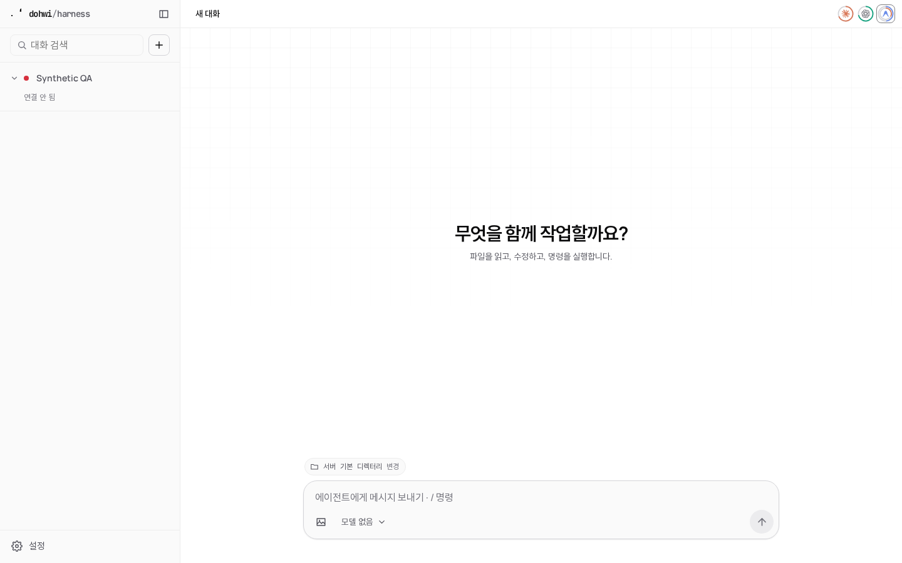
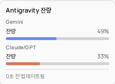
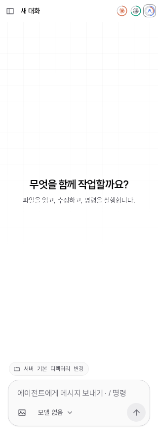

<div align="center">
  <h1>pipaya-extension-quota-monitor</h1>
  <p>dohwi/pipaya 클라이언트를 위한 실시간 AI 공급자 쿼터 모니터링 확장 — CLIProxyAPI & quota-monitor 연동</p>

  <p>
    <a href="https://github.com/dohwi/pipaya" target="_blank" rel="noreferrer"></a>
    <a href="https://svelte.dev" target="_blank" rel="noreferrer"></a>
    <a href="https://tauri.app" target="_blank" rel="noreferrer"></a>
    <a href="https://nodejs.org" target="_blank" rel="noreferrer"></a>
    <a href="https://developer.mozilla.org/en-US/docs/Web/JavaScript" target="_blank" rel="noreferrer"></a>
    <a href="https://github.com/dohwi/cliproxyapi-plugin-quota-monitor" target="_blank" rel="noreferrer"></a>
  </p>
</div>

---

## Preview

| 상단 네비게이션 바 게이지 (Navbar View) | 전체 잔량 팝오버 (Hover Details) |
| :---: | :---: |
|  |  |

<details>
<summary>모바일 및 좁은 화면(320px) 뷰 확인하기</summary>
<br />
<p align="center">
  
</p>
</details>

---

## Overview

`pipaya-extension-quota-monitor`은 [dohwi/pipaya](https://github.com/dohwi/pipaya) LLM 코딩 에이전트 클라이언트의 상단 네비게이션 바(Navbar)에 **upstream이 제공하는 AI 공급자(Claude · GPT · Antigravity)의 전체 잔량(%)**를 표시해 주는 공식 클라이언트 확장(`quota-monitor`)입니다.

### 연동 생태계 구성

이 시스템은 코딩 에이전트 워크플로우를 최적화하기 위해 다음과 같은 컴포넌트들의 협업으로 구성됩니다:

```
┌────────────────────────────────────────────────────────────────────────┐
│                        AI Upstream Providers                           │
│        (Anthropic Claude, OpenAI Codex/GPT, Google Gemini, etc.)       │
└───────────────────────────────────┬────────────────────────────────────┘
                                    │ Rate-limit & Quota Headers/API
                                    ▼
┌────────────────────────────────────────────────────────────────────────┐
│                   CLIProxyAPI (Proxy & Gateway)                        │
│  ┌──────────────────────────────────────────────────────────────────┐  │
│  │ cliproxyapi-plugin-quota-monitor (Native Server Plugin)          │  │
│  │ - 각 AI 계정의 잔여량·리셋 시각을 주기적으로 업스트림에서 관측     │  │
│  │ - 읽기 전용 엔드포인트로 노출:                                   │  │
│  │   GET /v0/management/plugins/quota-monitor/data/accounts         │  │
│  └────────────────────────────────┬─────────────────────────────────┘  │
└───────────────────────────────────┼────────────────────────────────────┘
                                    │ HTTP GET JSON (Sandboxed Worker)
                                    ▼
┌────────────────────────────────────────────────────────────────────────┐
│                     dohwi/pipaya Client                               │
│  ┌──────────────────────────────────────────────────────────────────┐  │
│  │ pipaya-extension-quota-monitor (Sandboxed Web Worker)           │  │
│  │ 1. Event trigger: run_finished (2.5초 후 후속 폴링) 및 주기 폴링 │  │
│  │ 2. Data model: upstream 전체 잔량 매핑           │  │
│  │ 3. UI emission: sdk.navbar.set('usage', { rings, details })      │  │
│  └────────────────────────────────┬─────────────────────────────────┘  │
│                                   │ Declarative UI nodes               │
│                                   ▼                                    │
│  ┌──────────────────────────────────────────────────────────────────┐  │
│  │ Navbar & UI (Svelte 5 / Tauri 2)                                 │  │
│  │ - Claude · GPT · Antigravity (Gemini/Claude Dual Ring) 게이지    │  │
│  │ - 마우스 오버 시 전체 잔량 & 업데이트 시각 팝오버│  │
│  └──────────────────────────────────────────────────────────────────┘  │
└────────────────────────────────────────────────────────────────────────┘
```

1. **dohwi/pipaya**: Bun + Fastify 백엔드와 Svelte 5 + Tauri 2 프론트엔드로 이루어진 코딩 에이전트. Opaque-origin Web Worker 기반의 샌드박스 확장 시스템(SDK v1)을 내장하고 있습니다.
2. **CLIProxyAPI (`cliproxy`)**: Claude, Codex, Gemini 등 다양한 AI 제공자의 복수 계정/키를 한곳에서 라우팅하고 프록시하는 게이트웨이입니다.
3. **`cliproxyapi-plugin-quota-monitor` 플러그인**: CLIProxyAPI 서버에 직접 탑재되는 네이티브 플러그인([dohwi/cliproxyapi-plugin-quota-monitor](https://github.com/dohwi/cliproxyapi-plugin-quota-monitor)). 각 AI 제공자 계정의 실제 한도(5시간 윈도우, 주간 한도, 리셋 시각 등)를 주기적으로 업스트림에서 관측하여 리소스 엔드포인트로 노출합니다.
4. **`pipaya-extension-quota-monitor` (본 확장)**: pipaya 클라이언트에 설치되어 quota-monitor의 관측 데이터를 수집하고, 채팅창 상단 네비게이션 바에 실시간 원형 링 게이지와 상세 팝오버를 직관적으로 렌더링합니다.

---

## 어떤 것을 구현할 수 있게 해주는가? (Features)

에이전트와 대화하는 도중 한도가 얼마나 남았는지 확인하기 위해 별도 대시보드나 CLI를 열 필요 없이, pipaya 상단 바에서 실시간 현황을 파악할 수 있습니다.

### 1. 전체 잔량 기준 원형 링 게이지
- 토큰 사용량이나 비용 추산치가 아닌 **upstream `availability[].remaining_percent`** 값 그대로 링을 채웁니다.
- 고정 브랜드 순서: **Claude** (주황) → **GPT / Codex** (녹색) → **Antigravity** (이중 링). (직접 연결된 Gemini 계정이 있는 경우 GPT와 Antigravity 사이에 자동 배치)
- **Antigravity 전용 이중 링**: 바깥 링은 Gemini 잔량, 안쪽 링은 Claude via Antigravity 잔량으로 분리 표시하여 공식 계정과 혼동되지 않습니다.

### 2. 잔여량 위험도별 동적 색상 에스컬레이션
- **정상 (20% 초과)**: 공급자 고유 브랜드 컬러 유지
- **주의 (20% 이하)**: 경고 황색 (`warn`)
- **위험 (5% 이하)**: 한도 소진 임박 적색 (`danger`)

### 3. 간결한 전체 잔량 팝오버
- 게이지에 마우스 오버 또는 키보드 포커스 시 전체 잔량만 표시합니다.
- Claude·GPT·직접 연결된 Gemini는 잔량 막대 하나, Antigravity는 Gemini와 Claude/GPT 잔량 막대를 각각 표시합니다.
- 전체 가용률·이용률 같은 집계 라벨, 5시간·주간·세부 버킷 한도 및 리셋 시각은 표시하지 않습니다.
- 팝오버 하단에 quota-monitor가 실제 측정한 시각 기준으로 `N초 전 업데이트됨`을 1초마다 실시간 갱신합니다.

### 4. upstream 전체 잔량과 일치하는 표시
- **서버 집계값 직접 사용**: `claude`, `codex`, `antigravity_gemini`, `antigravity_claude` 키를 각 링에 매핑합니다. 최근 사용 계정이나 계정별 최저 잔량으로 대체하지 않습니다.
- **집계 규칙은 upstream 소유**: 5시간 잔량, 주간 소진에 따른 차단, 계정 포함 여부와 전체 평균은 서버가 계산하며 확장은 재계산하지 않습니다.
- **미확인 값 보존**: `availability` 또는 해당 항목이 없거나 비율이 유효하지 않으면 링을 미확인으로 표시합니다. 이 필드를 제공하는 quota-monitor 버전이 필요합니다.
- **일관된 잔량 표시**: 링과 팝오버는 동일한 서버 집계값만 사용하며 계정별 한도는 표시하거나 재계산하지 않습니다.

### 5. 에이전트 라이프사이클 이벤트 연동
- 코딩 에이전트가 턴을 완료하면(`run_finished` 이벤트), 2.5초 후 즉시 후속 갱신을 예약하여 에이전트 작업으로 소진된 쿼터가 즉각 반영됩니다.

### 6. 엄격한 제로 트러스트 샌드박스 보안
- 브라우저의 Opaque-origin Worker 샌드박스에서 격리 실행되어 DOM 직접 조작, Tauri 내부 권한, 앱 인증 토큰에 접근할 수 없습니다.
- quota-monitor v0.2.0부터 데이터는 관리 인증 경로에서만 제공됩니다. 확장은 읽기 전용 스냅샷만 조회합니다. 관리 키(`httpToken`)는 `settingsScope: server`에 따라 서버의 `extensions/quota-monitor/settings.json`에 **평문으로 저장되고**, 서버에 연결된 모든 기기가 같은 값을 받아 각 기기의 로컬 저장소에도 캐시됩니다. 서버 토큰을 가진 사람은 이 관리 키를 읽을 수 있습니다. `secret` 필드는 비밀번호 입력으로 표시되고 configuration 내보내기에서는 제외됩니다. 기기를 분실하면 서버 토큰과 함께 관리 키도 교체하세요.

---

## 어디서 정보를 받아오는가? (Data Source)

- **데이터 엔드포인트**:
  ```text
  GET <httpOrigin>/v0/management/plugins/quota-monitor/data/accounts
  ```
- **데이터 제공 주체**: CLIProxyAPI 서버의 `quota-monitor` 플러그인
- **수집 방식**:
  - `sdk.http.requestJson({ path })`으로 스냅샷을 조회합니다. 호스트가 확장 자신의 `httpToken`을 `Authorization: Bearer` 헤더로 첨부하며, 키를 URL에 넣거나 직접 헤더를 구성하지 않습니다.
  - 쿠키와 앱 서버 인증 토큰은 전송하지 않으며 HTTP Redirect를 거부합니다. SDK 제약으로 `http-write` 권한이 필요하지만 이 확장의 요청은 GET뿐입니다.
  - 키가 없거나 401/403으로 거부되면 네트워크 요청을 중단하고 로컬 설정만 다시 확인합니다. 키가 바뀌면 복구합니다. 호스트의 5회 인증 실패 / 30분 IP 차단을 피하기 위한 보호입니다.
  - 에이전트 실행 완료 이벤트(`run_finished`) 발생 시 2.5초 후 즉시 조회 트리거
  - 주기적인 백그라운드 폴링 (서버 힌트 또는 사용자 지정 주기, 기본 60초)
  - 2초 이내 중복 호출 방지(Debouncing) 및 네트워크 장애 시 지수 백오프 (최대 5분) 적용

---

## Getting Started

[mise](https://mise.jdx.dev)를 통해 개발 및 빌드 환경을 설정합니다:

```bash
# 런타임 활성화
mise trust
mise install

# 번들 빌드 및 테스트 일괄 검증
npm run check
```

### pipaya 클라이언트에 확장 설치하기

1. 빌드된 단일 JSON 패키지 파일을 확인합니다:
   ```text
   dist/quota-monitor.json
   ```
2. `dohwi/pipaya` 클라이언트를 실행하고 **설정(Settings) → 확장(Extensions)** 메뉴로 이동합니다.
3. **패키지 가져오기**를 클릭하여 `dist/quota-monitor.json` 파일을 선택합니다.
4. 확장 설정에서 CLIProxyAPI 서버 origin과 관리 키를 입력하고 **설정 저장**을 누릅니다:
   ```json
   {
     "httpOrigin": "https://your-cliproxy.example",
     "httpToken": "<CLIProxyAPI management key>",
     "pollSeconds": 60
   }
   ```
   > **Note**: `httpOrigin`은 경로(`/v0/...`)나 API 키가 없는 순수 `http(s)://host:port` 형식이어야 합니다. `pollSeconds`를 비워두면 서버 hint(통상 60초)를 자동으로 따릅니다.
5. 요청 권한(`navbar`, `http-write`, `events`)을 확인하고 동의한 뒤 **Quota Monitor 사용** 스위치를 켭니다. v0.1.0/v0.2.0에서 업데이트할 때는 같은 ID의 JSON을 다시 가져온 뒤 새 권한을 승인해야 합니다. 설정은 `settingsScope: server`라서 한 기기에서 `httpOrigin`·`httpToken`을 저장하면 서버를 통해 모든 기기에 동기화됩니다. 단, 확장을 켜는 스위치와 권한 승인은 기기별로 따로 해야 합니다. v0.2.0에서 기기 로컬에 저장한 키가 있으면 서버 값이 우선합니다.
6. 상단 네비게이션 바에 실시간 원형 쿼터 게이지가 표시됩니다.

---

## Configuration

`manifest.json`에 정의된 확장 설정 필드:

| Field | Type | Default | Description |
|---|---|:---:|---|
| `httpOrigin` | `string (origin)` | *(필수)* | quota-monitor 플러그인이 설치된 CLIProxyAPI의 origin 주소 (예: `http://100.85.51.107:8317`) |
| `httpToken` | `string (secret)` | *(필수)* | CLIProxyAPI 관리 키. 서버에 평문 저장되어 모든 기기와 동기화, configuration 내보내기 제외, URL 미전송 |
| `pollSeconds` | `number` | `null` | 백그라운드 갱신 주기(초, 10~900초). 비워두면 서버 hint 주기를 따름 |

---

## Development & Verification

각 모듈은 순수 모델 계층과 SDK 목(Mock) 계층으로 완전히 분리되어 노드 내장 테스트 환경에서 격리 검증됩니다.

```bash
# 단일 비동기 Worker 코드 번들링 및 dist/quota-monitor.json 생성
npm run build

# Node.js 내장 테스트 슈트 실행
npm test

# 빌드 및 테스트 일괄 검증
npm run check
```

### 소스코드 구조

```
pipaya-extension-quota-monitor/
├── dist/
│   └── quota-monitor.json        # pipaya 클라이언트에서 가져올 최종 배포 패키지
├── docs/                         # 데스크톱/모바일 UI 미리보기 에셋
├── scripts/
│   ├── build.mjs                 # 소스 모듈 번들링 및 무결성 검증
│   └── check-browser.cjs         # 헤드리스 브라우저 통합 QA 스크립트
├── src/
│   ├── extension.js              # SDK 라이프사이클, 타이머 및 이벤트 핸들러
│   ├── model.mjs                 # 전체 잔량 매핑, 관측 시각 및 폴링 정책
│   ├── view.mjs                  # 선언형 navbar UI 노드 생성기
│   └── logos.mjs                 # 브랜드별 인라인 SVG Path 데이터
├── tests/                        # 노드 단위 및 SDK 모의 테스트
├── manifest.json                 # 확장 권한 명세 및 설정 스키마
├── package.json
├── mise.toml
└── README.md
```
