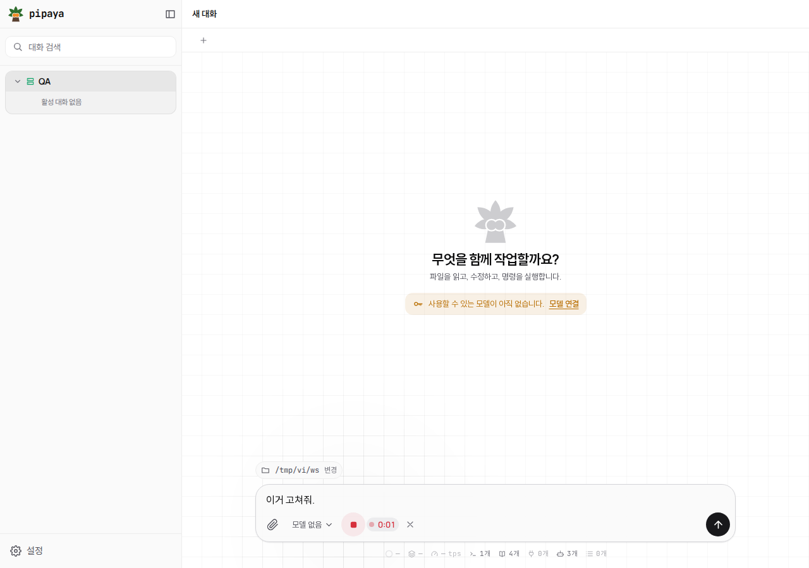
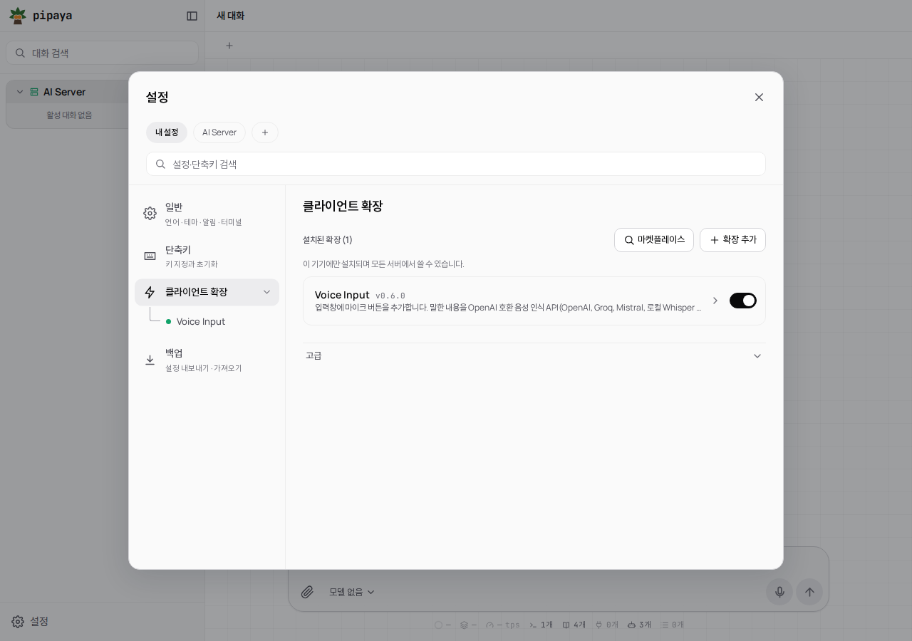
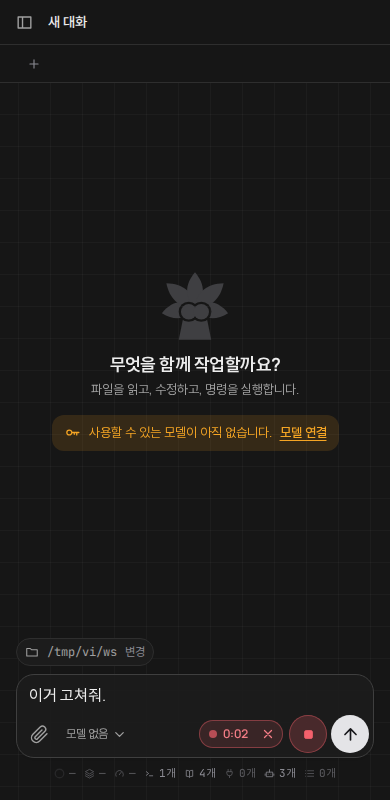

<p align="center"><a href="README.md">English</a> · <b>한국어</b></p>

# voice-input

[pipaya](https://github.com/dohwi/pipaya) 입력창의 마이크 버튼입니다. 누르고 말하고 다시 누르면 음성을 **OpenAI 호환 음성 인식 API**로 보내 받아쓴 글을 입력창에 붙여 넣습니다. 메시지를 대신 보내지는 않습니다.

| 녹음 중 | 설정 | 완료 (390px, 다크) |
| :---: | :---: | :---: |
|  |  |  |

## 필요한 것

- `POST <origin><경로>`에 multipart(`file`, `model`, `language`)와 `Authorization: Bearer` 키를 받고 `text` 필드가 있는 JSON을 돌려주는(OpenAI `audio/transcriptions` 형식) 음성 인식 서버. 그리고 **브라우저 요청을 허용(CORS)** 해야 합니다.
- 마이크가 켜지도록 **HTTPS**(또는 `http://localhost`)로 연 pipaya. https 페이지에서는 음성 인식 서버도 `https://`여야 합니다. [HTTPS](#https) 참고.
- pipaya가 HTTPS이면 pipaya의 **서버 주소도 HTTPS**여야 합니다(혼합 콘텐츠 차단). [서버 주소](#서버-주소-https) 참고.

## 설치

1. `npm run build` (또는 `dist/voice-input.json` 사용).
2. pipaya **설정 → 클라이언트 확장 → 확장 추가**에서 `dist/voice-input.json`을 가져옵니다(비활성으로 시작).
3. **Voice Input**을 열어 설정을 채우고 **설정 저장** 후 켜서 안내를 승인합니다.

| 설정 | 기본값 | 설명 |
| --- | --- | --- |
| `apiBase` | *(필수, 없음)* | 서버 origin. 예: `https://api.openai.com`. **https 페이지에서는 https**여야 합니다([HTTPS](#https) 참고). 경로나 계정 정보는 넣지 마세요. 내장된 주소는 없고, 비었거나 형식이 틀리면 버튼이 안내만 하고 요청을 보내지 않습니다. 스킴 없이 입력(`api.example.com`)하면 `https://`로 해석하며 저장된 글자는 바꾸지 않습니다. |
| `transcribePath` | `/v1/audio/transcriptions` | `/`로 시작하는 요청 경로. 단순한 경로만 받습니다(스킴, 호스트, 쿼리, `..` 불가). 요청 주소는 `apiBase` + 이 경로입니다. |
| `apiKey` | *(필수, 없음)* | `Authorization: Bearer` 헤더로만 보냅니다. 비밀 필드. |
| `model` | *(빈 값)* | 모델 이름. 대부분의 호스팅 서비스는 필수입니다(아래 표). 비우면 보내지 않고 서버 기본값을 씁니다. 기본값이 없는 이유는 어떤 값을 넣어도 한 서비스에만 맞기 때문입니다. |
| `language` | `ko` | ISO 639-1 코드. 비우면 서버가 자동 감지. 모델이 `gpt-transcribe`면 `languages[]`로 보냅니다. |
| `shortcut` | *(빈 값 = 없음)* | 음성 입력 단축키. 예: `Alt+M`, `Mod+Shift+K`. [단축키](#단축키) 참고. |
| `shortcutMode` | `toggle` | `toggle` 또는 `hold`(누르는 동안 녹음). `shortcut`을 정했을 때만 쓰입니다. |

`settingsScope`는 **`local`**입니다. 키는 자격 증명이라, `server` 범위면 pipaya 서버에 평문으로 저장되어 연결된 모든 기기에 공유됩니다. `local`이면 이 브라우저/앱에만 남고 내보내기에서도 빠집니다. 대신 기기마다 한 번 입력해야 합니다.

## 서비스

`apiBase`, `transcribePath`, `model`을 아래처럼 넣습니다. 값은 각 서비스의 공개 문서에서 확인한 것이며(링크), 직접 운영하는 서버는 자기 주소를 쓰세요.

| 서비스 | `apiBase` | `transcribePath` | `model` 예 | 문서 |
| --- | --- | --- | --- | --- |
| OpenAI | `https://api.openai.com` | `/v1/audio/transcriptions` | `gpt-transcribe`(권장, 아래 참고) | [File transcription](https://developers.openai.com/api/docs/guides/speech-to-text) |
| Groq | `https://api.groq.com` | `/openai/v1/audio/transcriptions` | `whisper-large-v3-turbo`, `whisper-large-v3` | [Speech to text](https://console.groq.com/docs/speech-to-text) |
| Mistral | `https://api.mistral.ai` | `/v1/audio/transcriptions` | `voxtral-mini-transcribe-3`(API 레퍼런스 예시는 `voxtral-mini-latest`) | [File transcription](https://docs.mistral.ai/studio/audio/speech-to-text/transcribe-files) |
| 직접 운영하는 OpenAI 호환 서버(예: [speaches](https://github.com/speaches-ai/speaches), 예전 이름 faster-whisper-server) | 운영 중인 서버 주소 | 서버 문서가 안내하는 경로, 보통 `/v1/audio/transcriptions` | 서버가 제공하는 이름 | 해당 서버의 문서 |

참고:

- **OpenAI 모델.** OpenAI 문서는 `whisper-1`, `gpt-4o-transcribe`, `gpt-4o-mini-transcribe`를 지원 중단 예정(**2027년 2월 26일 종료**)으로 표시하고 `gpt-transcribe`를 권장합니다. 이 모델은 `language` 대신 `languages`를 받고 둘을 함께 보내지 말라고 안내하므로, `model` 설정이 정확히 `gpt-transcribe`일 때는 `language` 값을 `languages[]`로(`language`는 보내지 않고) 보냅니다. 다른 모델은 그대로 `language`를 보냅니다. 공식 문서 기준이며 OpenAI를 직접 호출해 검증하지는 않았습니다.
- **직접 운영하는 서버.** OpenAI 전사 요청 형식(multipart `file`, `model`, `language`, 응답은 JSON `{ "text": ... }`)을 구현한 서버면 됩니다. 경로가 다르면 `transcribePath`를 바꾸세요. 모든 서버가 이 형식을 쓰는 것은 아닙니다. 예를 들어 `whisper.cpp` 예제 서버는 `/inference`에서 자기 고유 형식으로 받으므로 OpenAI 호환 앞단이 필요합니다. 서버가 브라우저(CORS) 요청을 허용해야 하는 것도 같습니다.
- **확인한 범위.** 개발 중 OpenAI 호환 서버 한 곳에서 전체 흐름(녹음, 업로드, 입력창에 글)을 끝까지 확인했습니다. 위 상용 서비스는 공개된 요청 형식을 따르지만, 이 저장소의 작성자가 직접 호출해 보지는 않았습니다.

## 사용법

- 마이크는 전송 버튼 바로 왼쪽에 있습니다. 누르면 녹음이 시작됩니다(빨간 버튼, 경과 시간). 다시 누르면(정지 ■) 변환합니다. **✕**는 업로드 없이 취소합니다.
- 결과는 기존 초안 뒤에 공백으로 이어 붙습니다. 확인하고 직접 전송하세요.
- 5분이 지나면 자동으로 멈춥니다. 녹음이 끝나면(버튼이 제거될 때도) 마이크를 바로 닫습니다.

| 표시 | 의미 |
| --- | --- |
| https 주소 필요 | pipaya를 https로 열었는데 `apiBase`가 `http://`로 시작함(localhost 제외). 브라우저가 차단하므로 요청을 보내지 않습니다. `https://`로 바꾸세요. |
| HTTPS 화면 필요 | pipaya 자체를 `http://`(localhost 제외)로 열어서 브라우저가 마이크를 켜지 않습니다. 버튼이 흐리게 표시되고 누르면 이유를 알려 줍니다. |
| 주소 필요 | `apiBase`가 비었거나 http(s) origin이 아님(설정을 엽니다). |
| 경로 오류 | `transcribePath`가 `/`로 시작하는 단순 경로가 아님. |
| 키 필요 | 설정에 키가 없음(설정을 엽니다). |
| 키 거부됨 | 401/403. 반복 실패 시 차단을 피하려고 키를 바꿀 때까지 다시 요청하지 않습니다. |
| 경로 없음 | 404/405: 주소나 경로가 틀림. |
| 마이크 거부됨 / 마이크 없음 / 마이크 사용 불가 | 브라우저 사이트 설정에서 마이크 허용, 장치 확인, 다른 앱 종료. |
| 연결 실패 / 시간 초과 | `apiBase`에 닿지 않음(60초 제한), 또는 서버가 브라우저 요청(CORS)을 막음. |
| 서버 오류 | 그 밖의 비정상 응답. 모델 이름도 확인하세요. |
| 인식 없음 / 너무 짧음 | 빈 결과, 또는 0.4초 미만 녹음. |

## HTTPS

이 확장은 설정한 음성 인식 서버(`apiBase`)하고만 통신하고, pipaya 서버와는 통신하지 않습니다. HTTPS가 필요한 이유는 정확히 두 가지입니다.

1. **마이크.** 브라우저는 페이지가 보안 컨텍스트일 때만 마이크(`getUserMedia`)를 켭니다. `https://` 페이지이거나 `http://localhost` / `http://127.0.0.1`이어야 합니다. pipaya를 `http://<호스트>:<포트>`로 열면 마이크 버튼이 흐리게 표시되고, 누르면 이유를 알려 주며 녹음은 시작하지 않습니다. pipaya를 HTTPS로 여세요(리버스 프록시, `tailscale serve` 등).
2. **혼합 콘텐츠.** `https://` 페이지는 `http://` 서버를 호출할 수 없고 브라우저가 막습니다. 그래서 **https 페이지에서는 `apiBase`가 `https://`여야** 하고, 일반 `http://` 주소는 "https 주소 필요"로 거부하며 요청을 보내지 않습니다. 스킴 없이 입력하면 `https://`로 해석합니다.

그 외에는 모두 허용합니다. https가 *아닌* 페이지(예: `http://localhost` 화면과 `http://localhost:8000`의 로컬 Whisper, 또는 http 화면과 사설망 서버)에서는 `http://` `apiBase`를 쓴 그대로 사용합니다.

**https 페이지의 loopback 예외**: `http://localhost`, `http://127.0.0.1`, `http://[::1]`은 https 페이지에서도 허용합니다. 내 컴퓨터에서 도는 Whisper 서버용입니다. 헤드리스 Chromium 158에서 https 페이지가 이 세 주소를 `http`로 `fetch`하면 성공하고, 같은 호출을 공인 호스트로 하면 혼합 콘텐츠로 차단됨을 확인했습니다. 다른 사설 주소(`192.168.x.x`, `10.x.x.x`, `*.local`, LAN/tailnet IP)도 그 Chromium에서는 닿았지만 다른 브라우저와 버전에서는 보장되지 않아, https 페이지에서는 예외로 두지 않습니다. 그런 서버는 `https://` 주소를 주세요(리버스 프록시, `tailscale serve`).

## 단축키

**기본 단축키는 없습니다.** `shortcut`이 비어 있는 동안에는 아무것도 등록하지 않습니다. 확장 설정에 원하는 조합을 직접 입력하세요. 바로 적용되며 재시작은 필요 없습니다. **pipaya 0.7.1 이상이 필요합니다**([권한](#권한) 참고).

- **형식**: pipaya 자체 단축키와 같은 표기. `Mod`는 Ctrl(macOS는 ⌘), 그 뒤에 선택적으로 `Alt`, `Shift`, 마지막에 **키 하나**: `Alt+M`, `Mod+Shift+K`, `Alt+Space`. 대소문자는 구분하지 않습니다(`ctrl+shift+k`도 됩니다). pipaya가 입력창에 글자가 들어가지 않도록 `Mod` 또는 `Alt`를 요구하므로 F키 단독은 받지 않습니다. `Esc`, `Enter`, `Tab`, `Backspace`는 쓸 수 없습니다.
- **`toggle`**(기본): 한 번 누르면 녹음 시작, 다시 누르면 정지·변환·이어 붙이기. 마이크 버튼을 누르는 것과 똑같이 동작합니다.
- **`hold`**: 키를 누르고 있는 동안 녹음하고, 떼면 정지·변환·이어 붙이기. 0.3초보다 짧게 누르면 조용히 버립니다(업로드하지 않음). 실수로 살짝 눌러도 아무 일도 없습니다. 키를 누른 채 창이 포커스를 잃거나, 탭이 가려지거나, 설정에서 단축키 녹화를 시작해도 같은 방식으로 녹음이 끝나고 마이크는 항상 닫습니다.
- 입력창에 포커스가 있어도 동작합니다. 한글(또는 다른 IME) 조합 중과 키 자동 반복은 pipaya가 무시합니다.
- **설정 → 단축키**("확장" 그룹)에 확장 이름과 함께 표시됩니다. pipaya 자체 단축키가 같은 키를 쓰면 pipaya가 우선이며 그 화면이 알려 줍니다.
- 단축키를 정하면 마이크 버튼 툴팁에 조합과 모드가 표시됩니다.
- 버튼과 마찬가지로 시작할 수 없는 이유(주소/키 없음, 오프라인, https 화면 아님)를 조용히 실패하지 않고 알려 줍니다.
- 창(pane)이 여러 개면 포커스가 있는 창만 단축키에 반응합니다.

**pipaya가 이미 쓰는 조합**(예: 모델 선택 `Mod+M`, 새 대화 `Mod+N`)이면 pipaya가 먼저 키를 처리해 우선하며, 확장은 설정을 저장할 때 한 번 "단축키 충돌"로 알려 줍니다. 다른 확장이 이미 같은 조합을 쓰거나 pipaya가 거부하면 pipaya가 주는 이유를 대신 보여 줍니다. 다른 조합을 고르세요. 브라우저나 OS가 가져가는 조합(예: `Ctrl+W`, `Alt+Tab`)은 페이지에 아예 전달되지 않을 수 있습니다.

## 녹음 포맷

브라우저 `MediaRecorder`의 기본 포맷을 그대로 올립니다(Chrome/Firefox는 `audio/webm` opus, Safari는 `audio/mp4`). 파일 이름은 `voice.webm` / `voice.m4a`입니다. [OpenAI](https://developers.openai.com/api/docs/guides/speech-to-text)와 [Groq](https://console.groq.com/docs/speech-to-text)의 공식 문서는 webm과 m4a를 지원 포맷으로 명시합니다. Mistral을 포함한 다른 서비스는 문서에 지원 파일 형식 목록이 확인되지 않았으니(작성 시점) 해당 서비스 문서를 확인하세요. WAV 변환은 하지 않습니다.

## 업그레이드

0.4.0은 단축키를 pipaya의 자체 단축키 API(**pipaya 0.7.1 이상**)로 옮기고 `shortcuts` 권한을 추가합니다. 설치된 버전에 없던 권한을 새 버전이 요구하면 pipaya가 확장을 자동으로 다시 켜지 않습니다. 가져온 뒤 동의 화면을 확인하고 확장을 다시 켜세요. 설정은 유지됩니다. 단축키가 설정 → 단축키에도 표시되고, `Shift+Mod+k` 같은 표기는 정규화됩니다. 예전에 받던 F키 단독은 pipaya가 `Mod` 또는 `Alt`를 요구하므로 더 이상 유효하지 않습니다.

0.3.1은 디자인만 정리한 버전입니다(동작 변경 없음). 마이크가 전송 버튼과 같은 모양·크기·질감(38px 원형, 평소 회색, 녹음 중 danger 색, 사용 불가일 때 투명도 대신 섞은 색)이 되었고, 상태 칩은 여백이 있는 pill 모양이 되었으며, 취소 버튼은 녹음 칩 안으로 들어갔습니다. 스크린 리더가 경과 시간을 1초마다 읽지 않습니다.

0.3.0은 선택 사항인 단축키(`shortcut`, `shortcutMode`)를 추가합니다. 설정하기 전에는 아무것도 바뀌지 않습니다.

0.2.1은 버튼을 툴바(모델 선택 옆)에서 전송 버튼 왼쪽으로 옮깁니다. `dist/voice-input.json`을 다시 가져오세요. 설정은 유지됩니다.

## 서버 주소 (HTTPS)

코어 수정은 필요 없습니다. pipaya **설정 → (서버 탭) → 편집**에서 주소를 `https://<내 pipaya 서버>:<포트>`로, 토큰은 그대로 두고 저장합니다(저장 전에 연결을 확인합니다). 목록은 이 브라우저의 `localStorage`(`pipaya.servers`)에 저장됩니다. 기본 주소는 페이지 호스트에 8787 포트 `http`로 만들어지므로, HTTPS 화면에서는 브라우저마다 한 번 바꿔야 합니다.

## 권한

| 권한 | 이유 |
| --- | --- |
| `ui-components` | 앱의 `composer.send` 부품을 교체해 마이크를 전송 버튼 바로 옆에 둡니다. 원래 전송 컨트롤은 앱이 그대로 그립니다(`fallback`). 마이크와 업로드는 컴포넌트가 직접 처리하므로(`getUserMedia`, `fetch`) `http`, `composer`, `storage`, `context` 권한은 요청하지 않습니다. |
| `shortcuts` | 선택 사항인 단축키를 pipaya의 단축키 API로 등록합니다. 동의 화면에는 "단축키 등록"으로 보입니다. 설정에 조합을 입력하기 전에는 아무것도 등록하지 않습니다. |

**단축키에는 pipaya 0.7.1 이상이 필요합니다.** 이전 버전에는 컴포넌트용 단축키 API가 없어서, 확장은 설치되고 마이크 버튼도 그대로 동작하지만 단축키만 쓸 수 없습니다(조합을 입력하면 "앱 업데이트 필요"로 알려 줍니다).

### `composer.send` 교체에 대해

- 같은 부품은 한 확장만 교체할 수 있고 **먼저 설치된 확장이 적용됩니다.** 따라서 `composer.send`를 바꾸는 다른 확장과는 함께 쓸 수 없습니다.
- 다른 확장이 이미 점유한 경우의 증상: 마이크 버튼이 보이지 않습니다(다른 기능은 영향 없음). 해결: 그 확장을 끄거나 삭제한 뒤 이 확장을 다시 불러오거나, 이 확장을 먼저 설치하세요.
- 이 확장의 컴포넌트가 오류를 내면 앱이 원래 전송 버튼으로 되돌립니다. 전송은 이 확장에 의존하지 않습니다.
- 전송, 대기열, 끼워 넣기, 중지, 압축 취소는 앱의 원래 컨트롤이고 이전과 똑같이 동작하며, 마이크는 그 왼쪽에 놓일 뿐입니다. 앱이 오프라인이면 마이크는 비활성입니다.

> [!WARNING]
> `ui-components`는 이 확장의 Svelte 코드를 pipaya 앱 **안에서 샌드박스 없이** 실행하므로 앱이 가진 모든 것(대화, 서버 연결 정보, 토큰)에 접근할 수 있습니다. 키는 `apiBase`로 가는 `Authorization` 헤더로만 보내고 로그·다른 저장소·URL·메시지에 넣지 않지만(테스트로 확인), 신뢰하는 빌드만 설치하세요. 음성은 설정한 서비스로 전송되므로 그 서비스의 개인정보 약관을 확인하세요.

## 개발

```sh
npm run check   # 빌드 + 단위 테스트
```

신뢰 컴포넌트는 `pipaya`와 `svelte*`만 import할 수 있어서, `scripts/build.mjs`가 `src/helpers.mjs`(순수 함수, 테스트됨)를 `src/components/VoiceButton.svelte`에 인라인합니다. 결과물은 `dist/voice-input.json`입니다.

## 라이선스

MIT
