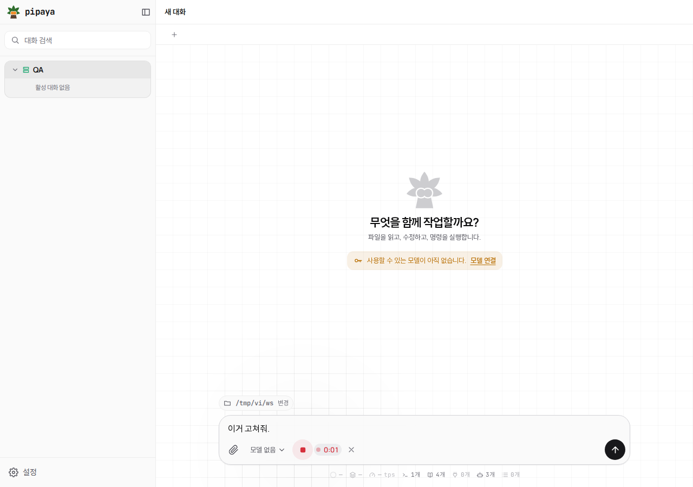
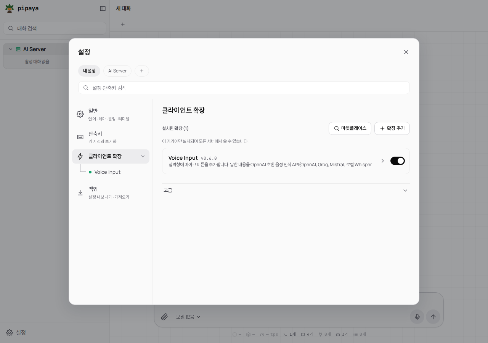
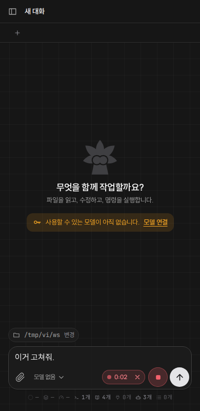

<p align="center"><b>English</b> · <a href="README.ko.md">한국어</a></p>

# voice-input

A microphone button in the [pipaya](https://github.com/dohwi/pipaya) composer. Press it, speak, press again: the audio is sent to **any OpenAI-compatible transcription API** and the text is appended to the input box. It never sends the message for you.

| Recording | Settings | Done (390 px, dark) |
| :---: | :---: | :---: |
|  |  |  |

## Requirements

- A transcription server that answers `POST <origin><path>` with multipart `file`, `model`, `language` and an `Authorization: Bearer` key, and returns JSON with a `text` field (the OpenAI `audio/transcriptions` format), and that **allows requests from the browser (CORS)**.
- pipaya opened over **HTTPS** (or `http://localhost`) so the microphone can start. On an https page the transcription server must be `https://` too. See [HTTPS](#https).
- When pipaya is on HTTPS, its own **server address must be HTTPS too** (mixed content is blocked). See [Server address](#server-address-https).

## Install

1. `npm run build` (or take `dist/voice-input.json`).
2. pipaya **Settings → Client extensions → Add extension**, choose `dist/voice-input.json`, import (starts disabled).
3. Open **Voice Input**, fill in the settings, **Save settings**, then turn it on and approve the notice.

| Setting | Default | Description |
| --- | --- | --- |
| `apiBase` | *(required, none)* | Origin of the server, for example `https://api.openai.com`. On an **https page it must be https** (see [HTTPS](#https)). No path or credentials. Nothing is built in: empty or malformed, the button asks for it and sends no request. A value typed without a scheme (`api.example.com`) is read as `https://`; the stored text is not changed. |
| `transcribePath` | `/v1/audio/transcriptions` | Request path, starting with `/`. Only a plain path is accepted (no scheme, host, query, `..`). The URL is `apiBase` + this path. |
| `apiKey` | *(required, none)* | Sent only as `Authorization: Bearer`. Secret field. |
| `model` | *(empty)* | Model name. Most hosted services require one (see the table). Empty: the field is not sent and the server default is used. There is no default because any value would suit only one service. |
| `language` | `ko` | ISO 639-1 code. Empty lets the server detect it. |

`settingsScope` is **`local`**: the key is a credential, and `server` scope would store it in plain text on the pipaya server and share it with every connected device. With `local` it stays on this browser/app only (and is never exported). Enter it once per device.

## Services

Set `apiBase`, `transcribePath` and `model` as below. Examples use each service's public address; use your own for self-hosted ones.

| Service | `apiBase` | `transcribePath` | `model` examples | Verified |
| --- | --- | --- | --- | --- |
| OpenAI | `https://api.openai.com` | `/v1/audio/transcriptions` | `whisper-1`, `gpt-4o-mini-transcribe` | Docs only (request format and model names read from the API reference). CORS not tested. |
| Groq | `https://api.groq.com` | `/openai/v1/audio/transcriptions` | `whisper-large-v3-turbo`, `whisper-large-v3` | Docs only (path and models read from Groq's speech-to-text page). Not called. |
| Mistral | `https://api.mistral.ai` | `/v1/audio/transcriptions` | `voxtral-mini-latest` | Docs only (route and model read from Mistral's API reference). Not called. |
| Local Whisper server (faster-whisper-server, whisper.cpp server, LiteLLM, …) | your server | usually `/v1/audio/transcriptions` | what the server lists | Not tried. Check the server's docs, and that it allows browser (CORS) requests. |
| CLIProxyAPI with the `mistral-support` plugin | your CLIProxyAPI | `/v0/management/audio/transcriptions` | `voxtral-mini-transcribe-3-0` | **Really run** end to end (record, upload, text in the input box). The key is the management key. The server adds its own term list, so the extension never sends `context_bias`. |
| Mock OpenAI-style server (test) | local | custom prefix path | any | **Really run**: multipart fields, Bearer header, route and error handling checked against a local mock. |

Only the last two rows were exercised with real requests. For the others the request format is the same as what was tested, but the service itself was not called, so treat them as "documented, not verified".

## Usage

- The microphone is just left of the send button. Click it: recording starts (red button, elapsed time). Click again (or the stop square) to transcribe. **✕** cancels without uploading.
- The text is appended after the current draft, separated by a space. Review it, then send yourself.
- Recording stops by itself after 5 minutes. The microphone is released as soon as recording ends (and when the button is removed).

| Message | Meaning |
| --- | --- |
| Use https | pipaya is open over https and `apiBase` starts with `http://` (not localhost). The browser would block it, so no request is sent; change it to `https://`. |
| HTTPS page needed | pipaya itself is open over plain `http://` (not localhost), so the browser will not start the microphone. The button is dimmed and explains this when pressed. |
| Address needed | `apiBase` is empty or not a bare http(s) origin (opens the settings). |
| Bad path | `transcribePath` is not a plain path starting with `/`. |
| Key needed | No key in the settings (opens the settings). |
| Key rejected | 401/403. No request is made again until the key changes, to avoid being blocked after repeated failures. |
| Not found | 404/405: wrong address or path. |
| Mic denied / No mic / Mic unavailable | Allow the microphone in the browser's site settings, check the device, close other apps using it. |
| Unreachable / Timed out | Cannot reach `apiBase` (60 s limit), or the server blocks browser requests (CORS). |
| Server error | Other non-2xx answers; also check the model name. |
| Nothing heard / Too short | Empty transcript or recording under 0.4 s. |

## HTTPS

The extension talks only to the transcription server you configure (`apiBase`); it never talks to the pipaya server. HTTPS matters for exactly two reasons:

1. **The microphone.** Browsers start it (`getUserMedia`) only when the page is a secure context: an `https://` page, or `http://localhost` / `http://127.0.0.1`. If pipaya is opened at `http://<host>:<port>` the mic button is dimmed and, when pressed, says so; no recording starts. Open pipaya over HTTPS (for example behind a reverse proxy, or with `tailscale serve`).
2. **Mixed content.** An `https://` page cannot call an `http://` server; the browser blocks it. So **on an https page, `apiBase` must be `https://`**, and a plain `http://` address is refused with "Use https" and no request is made. A value typed without a scheme is read as `https://`.

Everything else is allowed. On a page that is *not* https (for example `http://localhost` with a local Whisper server at `http://localhost:8000`, or an http page with a private-network server), a plain-http `apiBase` is used as written.

**Loopback exception on https pages**: `http://localhost`, `http://127.0.0.1` and `http://[::1]` are accepted even from an https page, for a Whisper server on your own machine. Checked in headless Chromium 158 (an https page `fetch` to each of the three over plain `http` succeeded, while the same call to a public host was blocked as mixed content). Other private addresses (`192.168.x.x`, `10.x.x.x`, `*.local`, a LAN or tailnet IP) were also reachable in that Chromium, but that is not guaranteed in other browsers or versions, so on an https page this extension does not treat them as an exception: give such a server an `https://` address (reverse proxy, `tailscale serve`).

## Recording format

The browser's own `MediaRecorder` format is uploaded as is (Chrome/Firefox: `audio/webm` opus, Safari: `audio/mp4`), named `voice.webm` / `voice.m4a`. OpenAI, Groq and Mistral list webm and m4a among the accepted formats. No WAV conversion is done.

## Upgrading

0.2.1 moves the button from the toolbar (beside the model picker) to the left of the send button. Re-import `dist/voice-input.json`; settings are kept.

### From 0.1.0

0.1.0 sent every request to `/v0/management/audio/transcriptions`. 0.2.0 reads `transcribePath` (default `/v1/audio/transcriptions`) and the setting is empty after an upgrade, so such setups break until you set `transcribePath` to `/v0/management/audio/transcriptions` and the model again. The key is unchanged.

## Server address (HTTPS)

No core change is needed. In pipaya: **Settings → (your server tab) → edit**, set the address to `https://<your-pipaya-server>:<port>` and the same token, save (the app verifies it first). The list is kept in this browser's `localStorage` (`pipaya.servers`). The default address is built from the page host with port 8787 over `http`, so on an HTTPS page it must be changed once per browser.

## Permissions

| Permission | Why |
| --- | --- |
| `ui-components` | The only one. Replaces the app's `composer.send` part so the microphone sits right beside the send button. The original send control is still drawn by the app (`fallback`), untouched. The microphone and upload are done by the component itself (`getUserMedia`, `fetch`), so no `http`, `composer`, `storage` or `context` permission is requested. |

### Replacing `composer.send`

- Only one extension can replace a given part, and **the first installed wins**. This extension therefore cannot be used together with another extension that replaces `composer.send`.
- Symptom if another extension already holds it: the microphone button is simply not there (nothing else breaks). Fix: turn that extension off (or delete it) and reload this one, or install this one first.
- If this extension's component fails, the app falls back to its normal send button, so sending never depends on it.
- Send, queue, steer, stop and the compaction cancel are the app's own controls and behave as before; the microphone is just placed to their left. It is disabled while the app is offline.

> [!WARNING]
> `ui-components` runs this extension's Svelte code **inside the pipaya app, without a sandbox**, so it can reach everything the app holds (chats, server connections, tokens). The key is only sent as an `Authorization` header to your `apiBase` and is never logged, stored elsewhere or put in a URL or message (tests enforce this), but install only builds you trust. Your voice goes to the service you configure; read its privacy terms.

## Development

```sh
npm run check   # build + unit tests
```

`src/helpers.mjs` (pure, tested) is inlined into `src/components/VoiceButton.svelte` by `scripts/build.mjs` because a trusted component may only import `pipaya` and `svelte*`. Output: `dist/voice-input.json`.

## License

MIT
